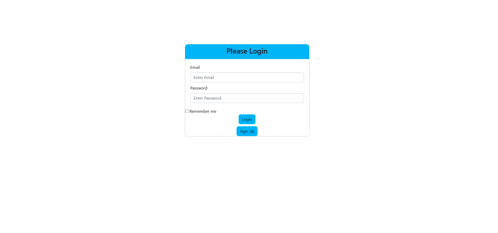
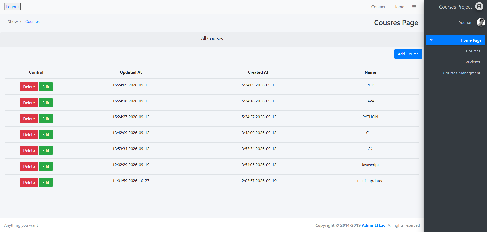
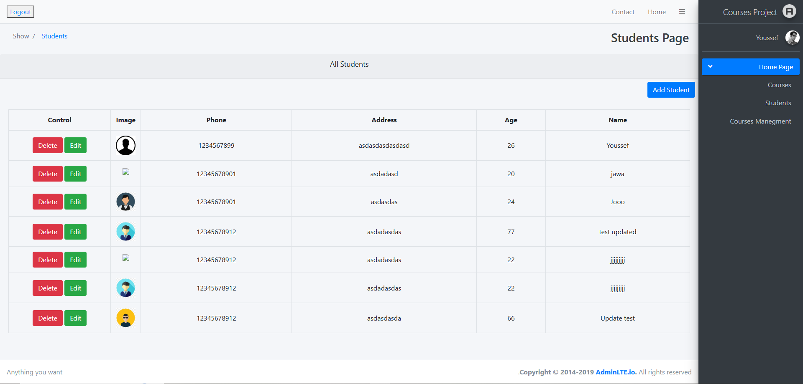

# Courses Project

An admin dashboard for a courses company, built with Laravel. Admins can log in and manage all courses and students from one place. The app also exposes a REST API secured with Laravel Sanctum tokens.

## Features
- Authentication: registration and login (session-based for the dashboard, token-based for the API)
- Dashboard: view, add and delete courses and students
- REST API with full CRUD for courses and students
- Token authentication with Laravel Sanctum
- Image upload, stored in `public/uploads`
- Form validation on all inputs
- Middleware protecting dashboard pages and API routes
- Consistent JSON responses for every API endpoint

## Tech stack
- PHP 8.2, Laravel
- Laravel Sanctum
- Eloquent ORM
- MySQL

## Code highlights
- **Eloquent models** for courses and students
- **Custom helper `apiResponse()`**: returns a consistent JSON structure for every API endpoint
- **Custom helper `UploadImage()`**: handles image uploads and stores them in `public/uploads`
- **Middleware** that restricts access to authenticated users
- **Two auth methods:** the dashboard uses session login, and the API uses Sanctum tokens

## Screenshots




## API authentication
Register or log in to receive a token (returned in `data.token`), then send it with every other request:

```
Authorization: Bearer <your-token>
Accept: application/json
```

Only `/api/register` and `/api/login` are public. All other endpoints require a valid token. Logging out revokes the token.

## API endpoints

### Authentication
| Method | URL | Auth | Description |
|---|---|---|---|
| POST | /api/register | No | Register a new user |
| POST | /api/login | No | Log in and receive a token |
| GET | /api/logout | Yes | Log out and revoke the token |

### Courses
| Method | URL | Auth | Description |
|---|---|---|---|
| GET | /api/courses_api | Yes | List all courses |
| POST | /api/courses_api | Yes | Create a course |
| GET | /api/courses_api/{id} | Yes | Show one course |
| PUT/PATCH | /api/courses_api/{id} | Yes | Update a course |
| DELETE | /api/courses_api/{id} | Yes | Delete a course |

### Students
| Method | URL | Auth | Description |
|---|---|---|---|
| GET | /api/students_api | Yes | List all students |
| POST | /api/students_api | Yes | Add a student |
| GET | /api/students_api/{id} | Yes | Show one student |
| PUT/PATCH | /api/students_api/{id} | Yes | Update a student |
| DELETE | /api/students_api/{id} | Yes | Delete a student |

### Example
```bash
# 1. Log in and copy the token from data.token in the response
curl -X POST http://localhost:8000/api/login \
  -H "Accept: application/json" \
  -d "email=admin@example.com" \
  -d "password=password"

# 2. Use the token on any protected endpoint
curl http://localhost:8000/api/courses_api \
  -H "Accept: application/json" \
  -H "Authorization: Bearer YOUR_TOKEN"
```

## Run locally
1. Clone the repo
   ```bash
   git clone https://github.com/youssefsayyed/Courses-Project.git
   cd Courses-Project
   ```
2. Install dependencies
   ```bash
   composer install
   ```
3. Set up the environment
   ```bash
   cp .env.example .env
   php artisan key:generate
   ```
4. Add your database details to `.env`
5. Create the tables
   ```bash
   php artisan migrate
   ```
6. Start the app
   ```bash
   php artisan serve
   ```

## What I learned
- Building CRUD with Eloquent, validation and middleware
- Securing an API with Laravel Sanctum tokens
- Designing a consistent REST API response format
- Handling file uploads with a reusable helper

## Author
Youssef Sayyed ([GitHub](https://github.com/youssefsayyed))